# AFDM-Based Integrated Sensing and Communication (ISAC) Simulation

<p align="center">
  <strong>MATLAB Simulation of a High-Mobility AFDM Waveform for Joint Communication and Radar Sensing</strong>
</p>

<p align="center">
  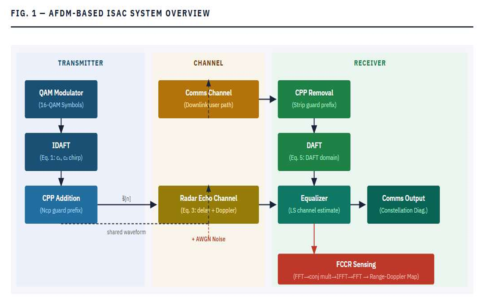
</p>

---

## Overview

This project implements and evaluates an **Affine Frequency Division Multiplexing (AFDM)-based Integrated Sensing and Communication (ISAC) system** in MATLAB.

The objective is to demonstrate how a **single AFDM waveform** can support both:

- wireless communication
- radar target sensing

within a high-mobility, delay-Doppler environment.

The project evaluates both communication and sensing performance using a complete simulation chain that includes AFDM modulation/demodulation, doubly-selective channels, pilot-aided channel estimation, equalization, BER analysis, Range-Doppler processing, and CFAR-based target detection. The project materials describe the motivation around Doppler sensitivity and the use of AFDM for simultaneous communication and sensing.  

---

## Why AFDM?

High mobility introduces significant Doppler effects that can degrade conventional OFDM-based communication and sensing systems.

AFDM is investigated as a waveform designed to better handle **delay-Doppler dispersion and high-mobility channels**.

```text
             High Mobility
                  │
                  ▼
          Delay + Doppler
                  │
                  ▼
        Conventional OFDM
            Performance
             Degradation
                  │
                  ▼
              AFDM
                  │
        ┌─────────┴─────────┐
        ▼                   ▼
  Communication          Sensing
        │                   │
        └─────────┬─────────┘
                  ▼
                ISAC
```

The project follows the AFDM-ISAC approach described in the provided project materials, where one waveform serves both communication and sensing functions. 

---

# System Architecture

<p align="center">
  
</p>

The implemented simulation follows this processing chain:

```text
Information Bits
      │
      ▼
   16-QAM
      │
      ▼
 Pilot Insertion
      │
      ▼
    IDAFT
      │
      ▼
 Chirp-Periodic Prefix
      │
      ▼
Doubly-Selective Channel
      │
      ├───────────────┐
      │               │
      ▼               ▼
Communication     Radar Echo
   Receiver          Model
      │               │
      ▼               ▼
    DAFT         Range-Doppler
      │             Processing
      ▼               │
Pilot-Aided LS       │
Estimation            │
      │               │
      ▼               ▼
ZF Equalization   FCCR / DAFT
      │               │
      ▼               ▼
 BER / SER / EVM   Range + Velocity
                      │
                      ▼
                    CFAR
                      │
                      ▼
               Target Detection
```

---

# Transmitter Chain

<p align="center">
  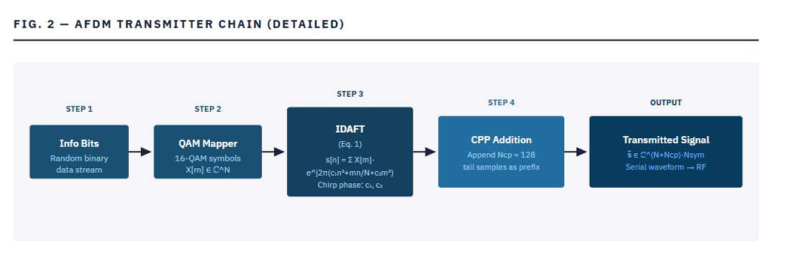
</p>

The transmitter consists of:

```text
Random Bits
    ↓
QAM Mapping
    ↓
Pilot Insertion
    ↓
IDAFT / AFDM Modulation
    ↓
Chirp-Periodic Prefix
    ↓
Transmitted AFDM Waveform
```

---

# Simulation Configuration

The current implementation uses the following main simulation parameters:

| Parameter | Value |
|---|---:|
| Subcarriers | 512 |
| AFDM symbols | 32 |
| Modulation | 16-QAM |
| Main SNR | 15 dB |
| SNR sweep | -5 to 30 dB |
| Monte-Carlo trials | 20 |
| Carrier frequency | 24 GHz |
| Subcarrier spacing | 22.729 kHz |
| Chirp-Periodic Prefix | 64 |
| Pilot spacing | 1 pilot every 8 subcarriers |
| Radar targets | 3 |
| Target ranges | 300 m, 200 m, 120 m |
| Target velocities | 20 m/s, 8 m/s, -8 m/s |

These values are taken from the implemented MATLAB simulation rather than invented for the README.  

---

# Communication Processing

The communication path includes:

```text
16-QAM
   ↓
Pilot Insertion
   ↓
AFDM Modulation
   ↓
Doubly-Selective Communication Channel
   ↓
DAFT Demodulation
   ↓
Pilot-Based LS Channel Estimation
   ↓
Zero-Forcing Equalization
   ↓
QAM Demodulation
   ↓
BER / SER / EVM
```

The MATLAB implementation performs pilot-aided least-squares channel estimation and ZF equalization before computing communication metrics. 

## Pilot Structure

Known pilot symbols are inserted using a comb-type pilot
pattern across the AFDM frame.

<p align="center">
  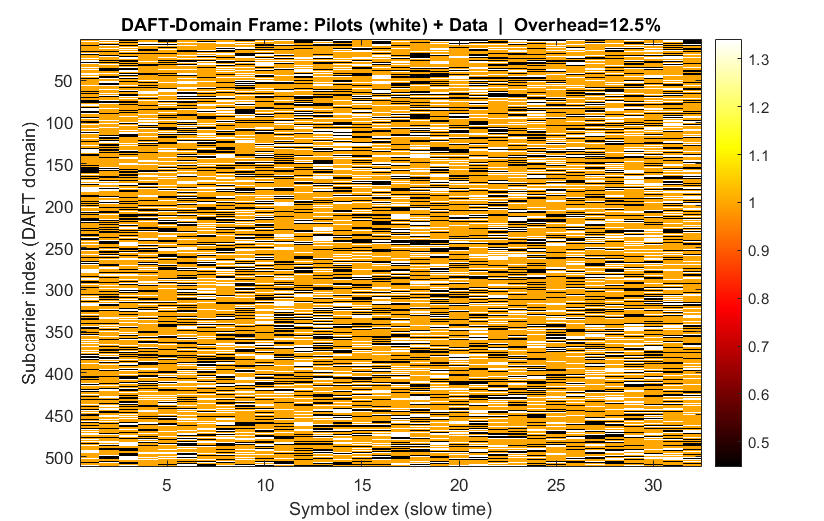
</p>

The implemented configuration uses one pilot every 8
subcarriers, giving a 12.5% pilot overhead.

---

# Radar Sensing Processing

The radar path models multiple targets with different delays and Doppler shifts.

```text
AFDM Waveform
      │
      ▼
Target Delay
      +
Target Doppler
      │
      ▼
Radar Echo
      │
      ▼
FCCR Processing
      │
      ▼
Range-Doppler Map
```

A second sensing path operates in the DAFT domain:

```text
AFDM Echo
    ↓
DAFT Domain
    ↓
DAFT-Based Sensing
    ↓
Range-Doppler Map
    ↓
CFAR Detection
```

The project source implements both **time-domain FCCR sensing** and **DAFT-domain sensing**, followed by CFAR detection. 

---

# Target Scenario

The simulation models three radar targets:

```text
Target 1 → Range = 300 m   | Velocity = +20 m/s
Target 2 → Range = 200 m   | Velocity =  +8 m/s
Target 3 → Range = 120 m   | Velocity =  -8 m/s
```

The source explicitly defines these target locations and velocities and converts them into propagation delays and Doppler frequencies. 

---

# Performance Evaluation

## 1. BER vs SNR

The project evaluates AFDM communication performance over an SNR sweep and compares AFDM with baseline waveforms.

<p align="center">
  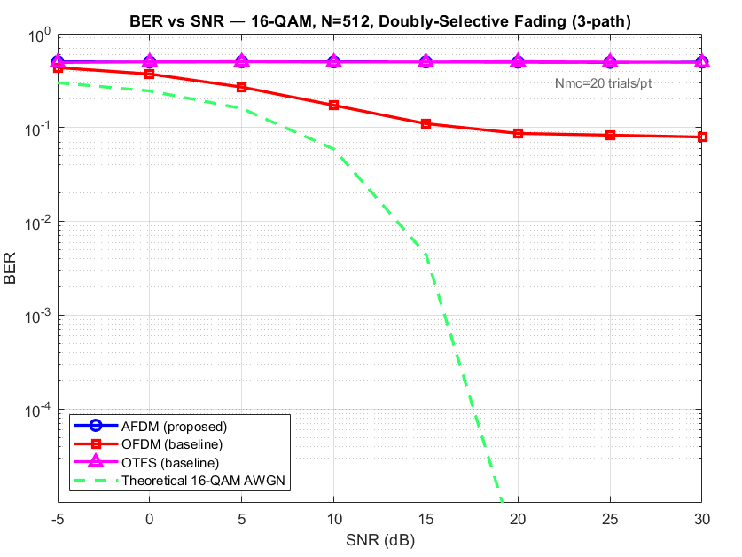
</p>

The implementation performs Monte-Carlo BER evaluation and also generates theoretical AWGN reference results. 

---

## 2. BER vs Normalized Doppler

The simulation evaluates communication robustness against
increasing normalized Doppler and compares AFDM with OFDM.

<p align="center">
  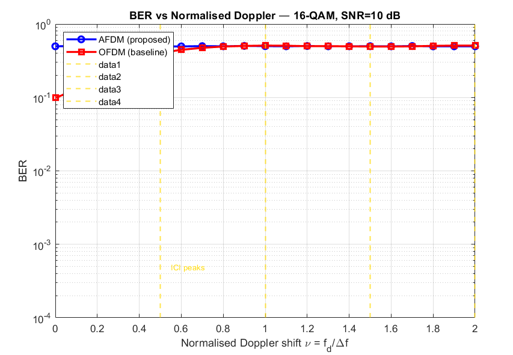
</p>

The sweep evaluates normalized Doppler from 0 to 2 at a fixed
SNR.

---

## 3. Constellation Analysis

The transmitted and recovered QAM symbol distributions are compared after channel estimation and equalization.

<p align="center">
  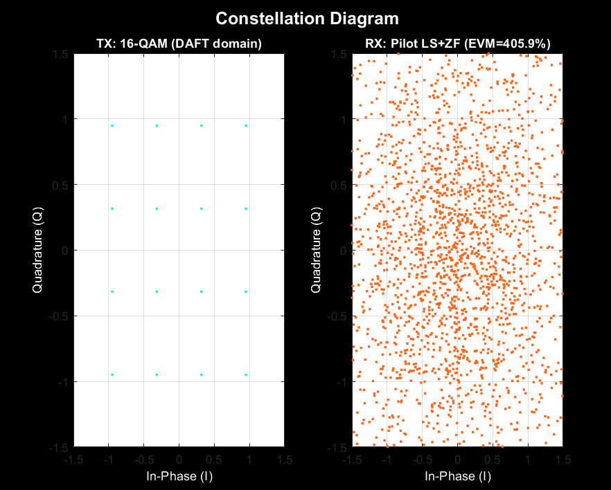
</p>

---

# Sensing Results

## FCCR Range-Doppler Map

<p align="center">
  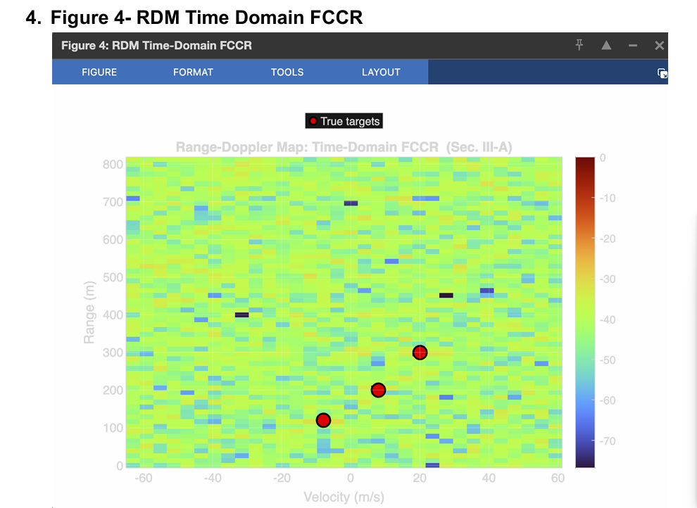
</p>

---

## FCCR 3D Range-Doppler Map

<p align="center">
  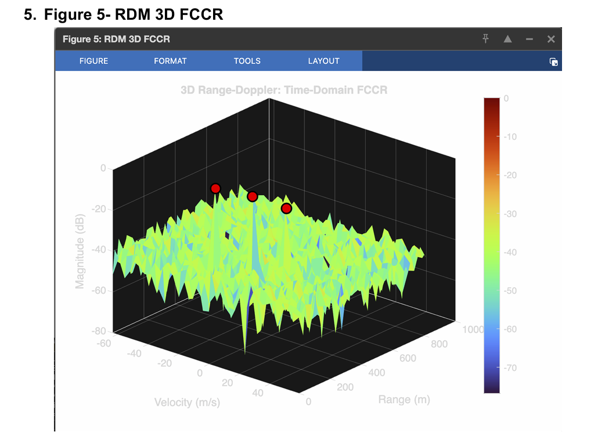
</p>

---

## DAFT-Domain Range-Doppler Map

<p align="center">
  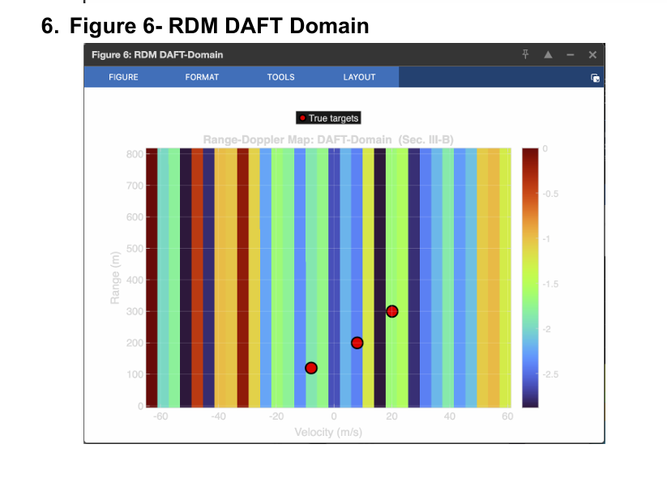
</p>

---

## DAFT-Domain 3D Range-Doppler Map

<p align="center">
  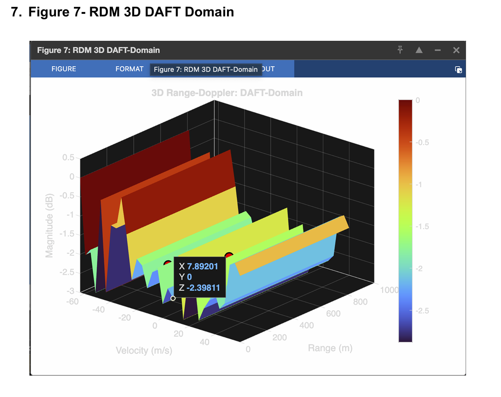
</p>

---

## Estimation Errors

<p align="center">
  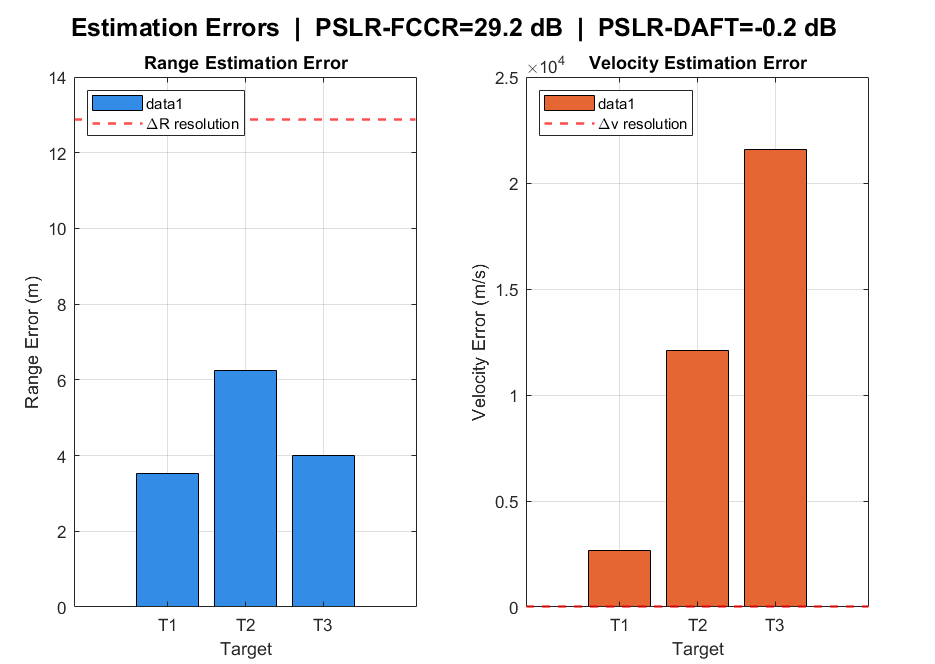
</p>

The project evaluates the difference between the known target range/velocity values and the values estimated by the sensing processing chain.

# Image SNR Analysis

The sensing image quality is evaluated as the input SNR varies.

<p align="center">
  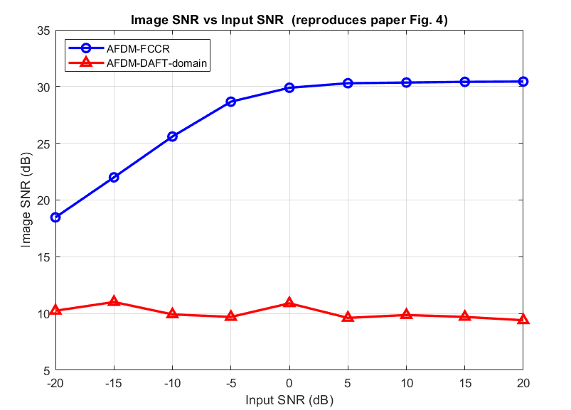
</p>

The comparison evaluates the image SNR obtained from the
AFDM-FCCR and AFDM-DAFT-domain sensing approaches.

---

# CFAR Detection

A **Cell-Averaging CFAR (CA-CFAR)** detector is applied to the DAFT-domain Range-Doppler response.

```text
Range-Doppler Map
       │
       ▼
   Power Map
       │
       ▼
Training Cells
       +
Guard Cells
       │
       ▼
Adaptive Threshold
       │
       ▼
Target Detection
```

The current implementation uses:

- Probability of false alarm: `1e-3`
- Training cells: `8`
- Guard cells: `2`

and extracts detected target range and velocity from connected detection regions. 

---

# Key Metrics

The simulation evaluates both communication and sensing metrics.

### Communication

- BER
- SER
- EVM
- Spectral efficiency
- BER vs SNR
- BER vs normalized Doppler

### Sensing

- Range estimation error
- Velocity estimation error
- PSLR
- Range-Doppler Maps
- CFAR detections
- Doppler ambiguity / velocity range

The source prints these metrics as part of the final simulation summary. 

---

# Technologies

```text
MATLAB
Signal Processing
Wireless Communications
Radar Signal Processing
AFDM
IDAFT / DAFT
16-QAM
Pilot-Based Channel Estimation
Zero-Forcing Equalization
Range-Doppler Processing
CFAR Detection
Monte-Carlo Simulation
```

---

# Project Structure

```text
AFDM-ISAC-Simulation/
│
├── src/
│   └── AFDM_ISAC_Simulation.m
│
├── results/
│   ├── communication/
│   │   ├── ber-vs-snr.png
│   │   ├── ber-vs-doppler.png
│   │   ├── constellation.png
│   │   └── pilot-structure.png
│   │
│   ├── sensing/
│   │   ├── estimation-errors.png
│   │   ├── image-snr-vs-input-snr.png
│   │   ├── fccr-rdm-2d.png
│   │   ├── fccr-rdm-3d.png
│   │   ├── daft-rdm-2d.png
│   │   └── daft-rdm-3d.png
│   │
│   └── detection/
│
├── docs/
│   └── architecture/
│       ├── system-overview.png
│       └── transmitter-chain.png
│
└── README.md
```

---

# How to Run

1. Open MATLAB.
2. Set the project directory as the MATLAB working directory.
3. Open:

```text
src/AFDM_ISAC_Simulation.m
```

4. Run the script.
5. Inspect the generated communication and sensing figures.

The simulation produces communication performance metrics, sensing maps, estimation-error plots, and detection results.

---

# Engineering Focus

This project demonstrates practical work across multiple areas of communication and sensing engineering:

```text
Wireless Communication
        │
        ├── Modulation
        ├── Channel Modeling
        ├── Channel Estimation
        └── Equalization
                │
                ▼
          Signal Processing
                │
        ┌───────┴────────┐
        ▼                ▼
     Radar            Communication
     Sensing             Metrics
        │                │
        ▼                ▼
 Range / Velocity     BER / SER / EVM
 Estimation
        │
        ▼
     CFAR Detection
```

---

# Future Improvements

Potential extensions include:

- More realistic multi-target and channel models
- Larger Monte-Carlo simulations
- More extensive AFDM vs OFDM vs OTFS comparisons
- Improved channel-estimation methods
- Advanced CFAR variants
- Joint communication-sensing optimization
- Real-time or software-defined-radio implementation
- Automotive radar-oriented scenario modeling

---

# Author

**Amit Tanwar**

Electronics and Communication Engineering

---

## Project Summary

This project investigates AFDM as an ISAC waveform for high-mobility communication and radar sensing.

The implementation combines:

```text
AFDM
+
16-QAM
+
Pilot-Based Channel Estimation
+
Doubly-Selective Channels
+
BER / EVM Analysis
+
FCCR Sensing
+
DAFT-Domain Sensing
+
Range-Doppler Maps
+
CA-CFAR Detection
```

The result is a MATLAB-based simulation framework that demonstrates how communication and sensing can be evaluated together within a single AFDM-based system.